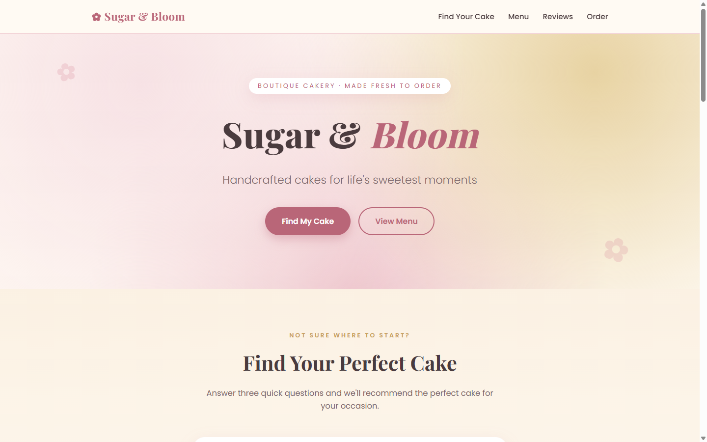
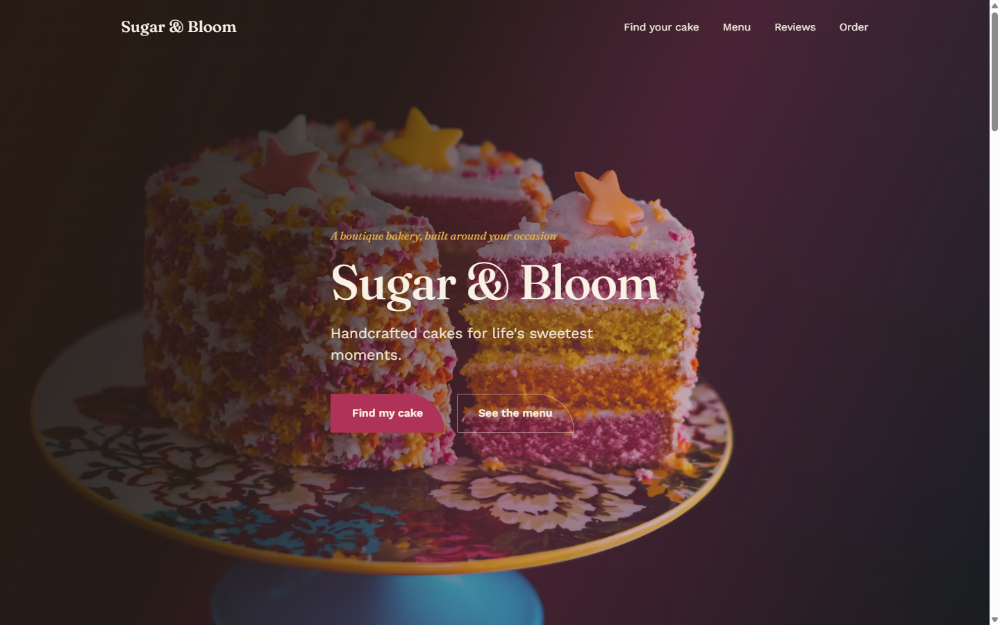
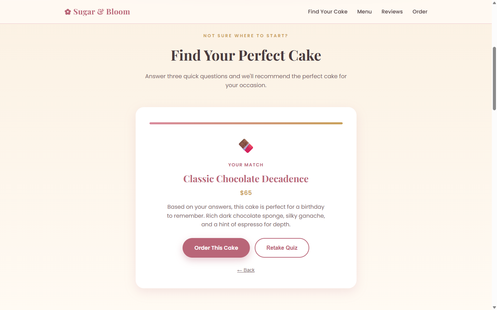
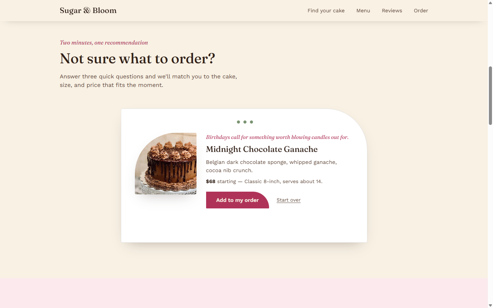
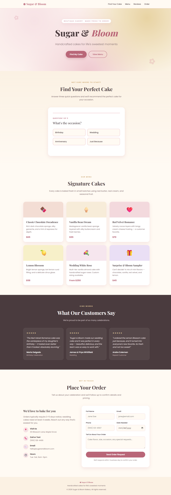
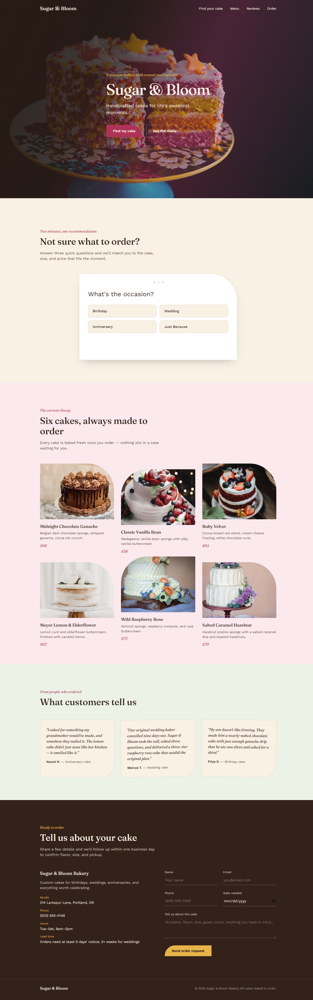
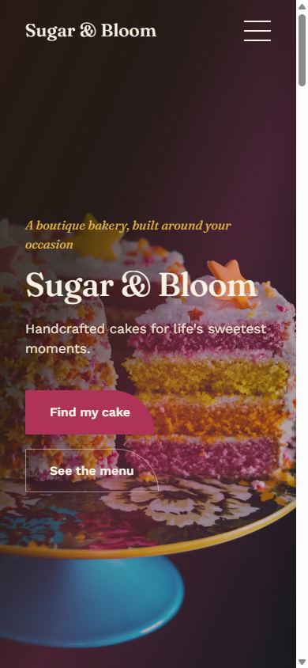

<div align="center">

# Landing Pages with Skills

*Same brief, same prompt, two builds: what a single Claude Code skill changes about design quality.*

[](https://developer.mozilla.org/docs/Web/HTML)
[](https://developer.mozilla.org/docs/Web/CSS)
[](https://developer.mozilla.org/docs/Web/JavaScript)
[](https://claude.com/claude-code)
[](https://github.com/anthropics/claude-code/tree/main/plugins/frontend-design)

[Overview](#overview) • [Before and after](#before-and-after) • [What the skill changed](#what-the-skill-changed) • [Projects](#projects) • [Run it](#run-it) • [How I built this](#how-i-built-this)

</div>

## Overview

This repo is an experiment in **Claude Code skills**. I gave Claude Code the same brief twice:
a landing page for *Sugar & Bloom*, a boutique bakery. The first build ran with no skill. The
second ran with Anthropic's [`frontend-design`](https://github.com/anthropics/claude-code/tree/main/plugins/frontend-design)
skill installed.

The prompt didn't change between builds. Both pages share the same section structure:

- a hero with the bakery name and tagline
- a one-question-at-a-time quiz (occasion → flavor → budget) that recommends a cake
- a six-cake menu
- three testimonials
- an order form

Each page is a single self-contained `.html` file, written in HTML, CSS and vanilla JavaScript
with no frameworks or build step.

## Before and after

| Without the skill | With `frontend-design` |
| --- | --- |
|  |  |
|  |  |
| Pleasant, but recognisably the default: soft gradient, emoji, centered everything, uppercase eyebrow labels. | Real photography, a specific palette, asymmetric shapes, and copy that sounds like a bakery wrote it. |

<details>
<summary><strong>Full-page comparison</strong></summary>

| Without the skill | With `frontend-design` |
| --- | --- |
|  |  |

</details>

### Mobile (with skill)



The with-skill build at phone width, with no horizontal scroll.

## What the skill changed

| | Without the skill | With `frontend-design` |
| --- | --- | --- |
| **Type** | Playfair Display + Poppins | Fraunces (variable optical size, italics for accents) + Work Sans |
| **Palette** | Blush, rose, cream, gold | Ivory, espresso, berry, sage, butter, held as named CSS tokens |
| **Hero** | Gradient with decorative flower shapes | Full-bleed cake photograph with a tinted overlay |
| **Quiz result** | Emoji, generic "Your match" | Cake photo, occasion-specific line, price with size and servings |
| **Labels and CTAs** | Tracked-out all-caps eyebrows, pill buttons | Italic serif kickers, one distinctive asymmetric button shape |
| **Copy** | "Find Your Perfect Cake", "What Our Customers Say" | "Not sure what to order?", "Six cakes, always made to order" |
| **Sections** | Uniform rounded cards throughout | Each section has its own background tint; the order form sits on espresso |

The skill doesn't add features. Both pages do the same things. What it changes is the design
decisions. It pushes for a direction specific to the brief and calls out common "AI-looking"
defaults to avoid.

## Projects

| Page | Folder | Built with |
| --- | --- | --- |
| Sugar & Bloom (no skill) | [`Build a business frontpage - no skills/`](Build%20a%20business%20frontpage%20-%20no%20skills/sugar_and_bloom.html) | Claude Code, no skills |
| Sugar & Bloom v2 | [`Build a business frontpage -with skills/`](Build%20a%20business%20frontpage%20-with%20skills/sugar_and_bloom_v2.html) | Claude Code + `frontend-design` |

## Run it

No install or build step is needed. Clone the repo and open any `.html` file in a browser.

```bash
git clone https://github.com/safia-raja/landing-pages-with-skills.git
```

> [!NOTE]
> Fonts load from Google Fonts and the v2 photos from Unsplash, so you need an internet
> connection for the pages to look as shown.

### Reproduce the experiment

1. Ask Claude Code for the bakery page with a structured prompt (see below).
2. Install the skill into the project:

   ```bash
   npx skills add anthropics/claude-code --skill frontend-design
   ```

   This puts the skill in `.claude/skills/` (for Claude Code) and `.agents/skills/` (for other
   agent runtimes). I left those folders out of the repo, so reinstall the skill with this
   command.
3. Run the same prompt again with the skill active and compare the two files side by side.

## How I built this

I didn't write the code by hand. Both pages were generated by
**[Claude Code](https://claude.com/claude-code)**. My role was the experiment itself:

- **Prompt design**: I wrote each brief in a Context / Instruction / Input / Output format so
  that the only variable between the two bakery builds was the skill
- **Controlled comparison**: I kept the business, tagline, quiz questions, menu size and form
  fields identical across both builds
- **Skill setup**: I installed `frontend-design` from Anthropic's repo before the second build
- **Review**: I opened the builds side by side and compared typography, color, layout and copy

## Credits

- Cake photography in v2 via [Unsplash](https://unsplash.com)
- [`frontend-design`](https://github.com/anthropics/claude-code/tree/main/plugins/frontend-design)
  skill by Anthropic
- Built as part of a Claude Code course project
